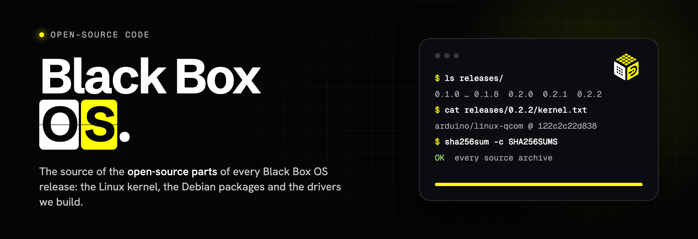

<p align="center">
  
</p>

<p align="center">
  <b>The source code of the open-source software in Black Box OS, for every release.</b><br>
  <sub>Linux kernel · Debian packages · the USB drivers we build · licences · written offer</sub>
</p>

<p align="center">
  <a href="#get-the-source-for-a-release">Get the source</a> &nbsp;·&nbsp;
  <a href="releases/">Releases</a> &nbsp;·&nbsp;
  <a href="#written-offer">Written offer</a> &nbsp;·&nbsp;
  <a href="#licences">Licences</a> &nbsp;·&nbsp;
  <a href="https://dashivo.app/hub/">Black Box OS</a>
</p>

---

## Black Box OS


**Black Box OS** turns your own Arduino UNO Q into a Dashivo Black Box: it hides under a seat, records the cameras and
the vehicle's data on its own, and your phones copy every clip to it over its own Wi-Fi. You flash it from your Dashivo
account, in your browser. It is Debian GNU/Linux on Arduino's UNO Q image and kernel, with Dashivo's Black Box software
on top. More at **[dashivo.app/hub](https://dashivo.app/hub/)**.

## What's in this repository

| | |
|---|---|
| 📦 **Every package, every release** | [`releases/<version>/packages.tsv`](releases/): each Debian package in the image, its exact version, its source package, the licences its copyright file names, where its source is and its checksum |
| 🐧 **The Linux kernel** | Arduino's UNO Q kernel `7.0.0-g122c2c22d838`, built from [`arduino/linux-qcom`](https://github.com/arduino/linux-qcom/tree/122c2c22d838ca826e7f4e7360df96fb4e8f7ad2) commit `122c2c22d838`, its configuration, and an archive of that exact tree |
| 🔧 **The drivers we add** | `releases/<version>/modules/`: the scripts that build the USB Wi-Fi, GPS and cellular drivers from that kernel source, unmodified, and their pinned inputs |
| 🗜️ **Source archives** | attached to this repository's [GitHub releases](../../releases), one per Black Box OS version (`bbos-<version>`), with `SHA256SUMS` |
| ⚖️ **Licences** | [`NOTICE`](NOTICE) and [`LICENSES/`](LICENSES/) (GPL-2.0, GPL-3.0, LGPL-2.0 / 2.1 / 3.0, Apache-2.0, MPL-2.0, the kernel's COPYING) |

### What's not here

Dashivo's own software in Black Box OS (the Black Box service, its settings and its tools) is proprietary to Angry Owl
Labs LLC and is not published. It runs as separate programs on top of the open-source system and does not change it.
The Dashivo apps, the Dashivo servers and the ESP32 accessory firmware are not part of this repository either.

## Releases

| Build | Channel | Built | Packages | Kernel |
|---|---|---|---:|---|
| [`0.2.2+1`](releases/0.2.2/) | Beta | 2026-10-25 | 959 | `122c2c22d838` |
| [`0.2.1+1`](releases/0.2.1/) | Beta · Public beta | 2026-10-25 | 959 ¹ | `122c2c22d838` |
| [`0.2.1+2`](releases/0.2.1/) | Beta · Public beta | 2026-10-25 | 959 ¹ | `122c2c22d838` |
| [`0.2.0+2`](releases/0.2.0/) | Stable | 2026-10-20 | 958 | `122c2c22d838` |
| [`0.2.0+3`](releases/0.2.0/) | Stable · Dashivo Pro | 2026-10-25 | 958 ¹ | `122c2c22d838` |
| [`0.1.8`](releases/0.1.8/) | Stable | 2026-10-18 | 958 | `122c2c22d838` |
| [`0.1.7`](releases/0.1.7/) | Beta | 2026-10-14 | 949 | `122c2c22d838` |
| [`0.1.6`](releases/0.1.6/) | Beta | 2026-10-14 | 949 | `122c2c22d838` |
| [`0.1.4`](releases/0.1.4/) | Beta | 2026-10-14 | 949 | `122c2c22d838` |
| [`0.1.3`](releases/0.1.3/) | Beta | 2026-10-14 | 949 | `122c2c22d838` |
| [`0.1.2`](releases/0.1.2/) | Beta | 2026-10-14 | 949 | `122c2c22d838` |
| [`0.1.1`](releases/0.1.1/) | Beta | 2026-10-14 | 949 | `122c2c22d838` |
| [`0.1.0`](releases/0.1.0/) | Beta | 2026-10-13 | 945 | `122c2c22d838` |

<sub>¹ No copy of this build's image was kept to read its package list from; the list is that of the build named in
its README (the same base image, pinned packages and build scripts). The source of every version in it is here.</sub>

## Get the source for a release

1. **Pick the version** your Black Box runs (Settings › About, or `/usr/share/doc/dashivo-open-source/release.txt` on the
   device) and open [`releases/<version>/`](releases/).
2. **Download the archives** listed in its `README.md` from the [GitHub releases](../../releases) (`bbos-<version>`
   and the earlier ones it points to). Each is a plain `tar` of Debian source packages (`.dsc`, `.orig.tar.*`,
   `.debian.tar.*`), one folder per package.
3. **Check them** against the release's `SHA256SUMS`, and each file against `sources.tsv`:

   ```sh
   sha256sum -c releases/0.2.2/SHA256SUMS
   ```

4. **Unpack a package** the usual Debian way: `dpkg-source -x <package>_<version>.dsc`.

Every Debian source in the lists is also on Debian's own servers at the exact version (`deb.debian.org`, or
`snapshot.debian.org` for versions that have left the archive); `sources.tsv` gives each file's URL and checksum.

**The kernel:** `bbos-0.1.0/linux-qcom-122c2c22d838ca826e7f4e7360df96fb4e8f7ad2.tar.gz`, or

```sh
git clone https://github.com/arduino/linux-qcom.git && git -C linux-qcom checkout 122c2c22d838ca826e7f4e7360df96fb4e8f7ad2
```

with the configuration in `releases/<version>/kernel-config-7.0.0-g122c2c22d838`.

**The drivers we build:** `releases/<version>/modules/` has the build scripts and `BUILD-INPUTS` (the kernel files, the
headers package and the firmware packages they use, with their SHA-256 checksums). They build each driver as an
external module against Arduino's headers package for this kernel, with Debian trixie's GCC 14.2, inside a
`debian:trixie` arm64 container, and run as root with the image's root file system as their only argument.

## Written offer

Black Box OS contains software licensed under the GNU General Public License (GPL), the GNU Lesser General Public
License (LGPL) and other open-source licences that require the source code to be made available. This repository
publishes that source for every release.

For at least three years after we last distribute a version of Black Box OS, Angry Owl Labs LLC will also give anyone
who asks a copy of the complete corresponding source code for that version, on a medium customarily used for software
interchange, for no more than our cost of physically performing the distribution.

To ask, write to **support@dashivo.app** with the subject "Black Box OS source code" and the version (Settings › About
on the Black Box, or `/usr/share/doc/dashivo-open-source/release.txt` on the device).

The same offer is on every Black Box at `/usr/share/doc/dashivo-open-source/WRITTEN-OFFER`, with the package list and the
kernel commit of the version it runs.

## Licences

Each component keeps its own licence: the Linux kernel GPL-2.0, each Debian package the licences in its
`debian/copyright` (installed on the device at `/usr/share/doc/<package>/copyright`), Arduino's tools GPL-3.0. The
texts used most are in [`LICENSES/`](LICENSES/); [`NOTICE`](NOTICE) has the details. This repository adds no licence of
its own to any of them.

The artwork in [`assets/`](assets/) (the Black Box OS logo and icon) is not open source.

## Trademarks

Dashivo™ and Black Box OS are trademarks of Angry Owl Labs LLC. The open-source licences in this repository don't grant
any rights to them. Arduino and UNO are trademarks of Arduino S.r.l.; Debian is a registered trademark of Software in
the Public Interest, Inc.; Linux is the registered trademark of Linus Torvalds. Black Box OS is not made, sponsored or
endorsed by Arduino, Debian or Qualcomm.

---

<p align="center">
  <picture>
    <source media="(prefers-color-scheme: dark)" srcset="assets/blackbox-os-horizontal-dark.svg">
    
  </picture>
  <br>
  <sub>Questions about this repository or a source code request: <b>support@dashivo.app</b> · © 2026 Angry Owl Labs LLC</sub>
</p>
